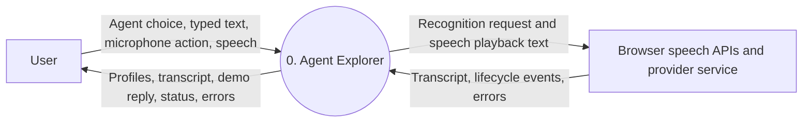
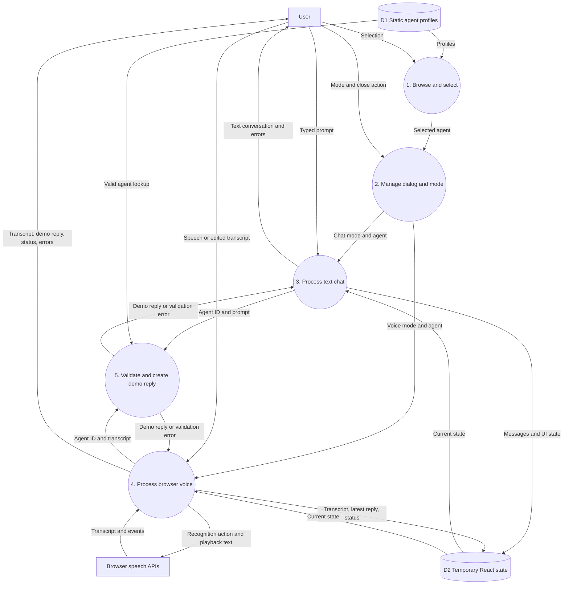
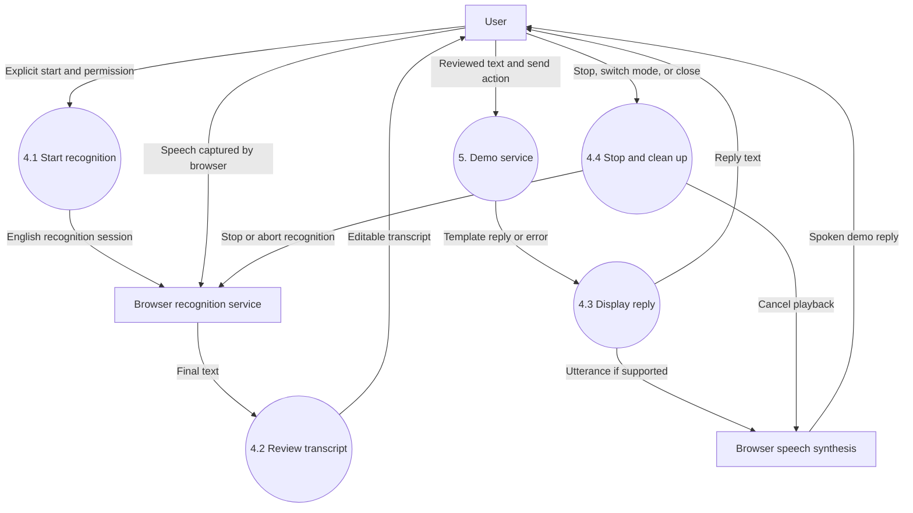

# How We Built Agent Explorer with React JavaScript

**A chapter-wise project showcase and technical walkthrough**

**Scope:** The application implemented so far: React setup, agent landing page,
text chat demo, and a separate browser voice demo.

> This is a working frontend prototype, not a production AI platform. The agent
> replies are local templates. No LLM, backend, database, authentication, or
> real-time AI voice provider is connected.

## Contents

1. [Project introduction](#chapter-1-project-introduction)
2. [Development journey](#chapter-2-development-journey)
3. [Libraries and technologies](#chapter-3-libraries-and-technologies)
4. [Folders and files](#chapter-4-folders-and-files)
5. [Architecture and React concepts](#chapter-5-architecture-and-react-concepts)
6. [Landing page and agent selection logic](#chapter-6-landing-page-and-agent-selection-logic)
7. [Text chat logic](#chapter-7-text-chat-logic)
8. [Voice agent logic](#chapter-8-voice-agent-logic)
9. [Data-flow diagrams](#chapter-9-data-flow-diagrams)
10. [SDLC](#chapter-10-sdlc)
11. [Testing and verification](#chapter-11-testing-and-verification)
12. [Running and building the project](#chapter-12-running-and-building-the-project)
13. [Limitations and future development](#chapter-13-limitations-and-future-development)
14. [Showcase presentation guide](#chapter-14-showcase-presentation-guide)

---

## Chapter 1: Project Introduction

### 1.1 What we built

**Agent Explorer** is a single-page React application where visitors can browse
ten domain-specific assistant profiles and open an agent window.

Each agent window offers two separate options:

- **Chat:** Type messages and view a local demonstration response.
- **Voice agent:** Dictate a message, review the transcript, and hear a
  demonstration response through browser speech synthesis.

The interface uses a dark green background, lime/green accents, a glowing orb
image, responsive cards, and a modal dialog.

### 1.2 Problem and objective

The objective was to create an understandable React foundation for an
AI-agent application, then turn it into a presentable interface based on a
supplied screenshot and reference project.

The prototype demonstrates:

- Component-based UI development.
- Data-driven rendering.
- Local state management and user interactions.
- Shared service logic.
- Browser speech API integration.
- Responsive design and accessible controls.

### 1.3 Agent directory

| Agent | Domain | Profile purpose |
| --- | --- | --- |
| Ava | Real Estate | Find, view, and book properties |
| Leo | Travel & Tourism | Plan trips, flights, and hotels |
| Mira | Online Grocery | Grocery ordering concept |
| Omar | Food & Dining | Reservations and meal ordering concept |
| Sara | Healthcare | Appointment booking concept |
| Max | Customer Support | Support questions |
| Nova | Geospatial | Maps, GIS, and location FAQs |
| Atlas | AI Software | Product, pricing, and API FAQs |
| Lex | Legal | Contracts and legal FAQs |
| Ruby | Matchmaking | Partner discovery concept |

These are profile descriptions, not implemented business integrations. For
example, Ava does not query property listings and Sara does not book appointments.

---

## Chapter 2: Development Journey

### Stage 1: Create a standard React JavaScript project

We scaffolded the application using the Vite React template:

```powershell
npm create vite@latest . -- --template react
npm install
```

We separated the application into components, pages, hooks, data, and services
instead of placing every feature in one large component.

### Stage 2: Build the initial agent workspace

The first interface included an agent selector, a chat panel, and a local
service that returned clearly labeled demonstration replies.

This established the interaction and service boundaries before adding a more
detailed visual design.

### Stage 3: Match the supplied landing-page design

We reviewed the reference project under
[prompt/agent-explorer-react](../prompt/agent-explorer-react) and adapted its
landing-page structure and ten profiles into the main JavaScript application.

We used the supplied orb image and implemented the design with plain CSS.
The reference project remained separate; we did not migrate the main app to
its TypeScript, router, or Tailwind stack.

### Stage 4: Add the agent preview dialog

Clicking a card opens a native HTML dialog containing the agent's identity,
greeting, conversation interface, and close controls.

We added Escape handling, background scroll locking, and focus restoration
when the dialog closes.

### Stage 5: Add a separate voice option

We introduced **Chat** and **Voice agent** mode buttons inside the dialog.
Voice mode uses browser speech recognition for input and speech synthesis for
output, while continuing to use the same local demo service.

### Stage 6: Verify the implementation

During implementation, we ran production builds, lint checks, service tests,
and browser interaction checks. Voice controls were exercised with simulated
speech APIs; this does not establish real microphone or audio-device behavior.

---

## Chapter 3: Libraries and Technologies

### 3.1 Installed application dependencies

The following ranges are declared in [package.json](../package.json). Exact
resolved dependencies are recorded in [package-lock.json](../package-lock.json).

| Package | Declared range | Role |
| --- | --- | --- |
| `react` | `^19.3.1` | Components, rendering logic, and hooks |
| `react-dom` | `^19.3.1` | Mounts React into the browser DOM |
| `vite` | `^8.3.5` | Development server and production bundling |
| `@vitejs/plugin-react` | `^6.1.2` | React integration with Vite |
| `oxlint` | `^1.89.0` | Static analysis and React lint rules |
| `@types/react` | `^19.3.0` | React type declarations for tooling |
| `@types/react-dom` | `^19.3.0` | React DOM type declarations for tooling |

The application source is **JavaScript and JSX**, not TypeScript. Installing
type declarations does not change the source language.

### 3.2 Other technologies used

| Technology | How we use it |
| --- | --- |
| JavaScript ES modules | `import` and `export` between modules |
| JSX | Describes component UI within JavaScript |
| HTML5 | Page shell, forms, buttons, sections, and native dialog |
| CSS | Grid, Flexbox, gradients, responsive media queries, focus styles |
| Inline SVG | Microphone and close icons without an icon package |
| Emoji | Agent avatar illustrations |
| Web Speech API | Browser speech recognition and speech synthesis |
| Node.js | Runs npm tooling and the built-in test runner |
| npm | Scripts, dependency installation, and lockfile management |
| `node:test` | Automated service and profile tests |
| `node:assert/strict` | Assertions without a third-party test library |
| Markdown and Mermaid | This documentation and its diagrams |

### 3.3 Deliberately not included in the running app

We do not currently use Redux, React Router, Tailwind CSS, Axios, an AI SDK,
Express, or a database.

- React local state is sufficient for the current interface.
- HTML anchors provide in-page navigation.
- Plain CSS provides the visual design.
- The service is local, so no HTTP client is needed yet.

The reference project has its own dependencies. Those should not be confused
with the technologies used by this application's entry point.

---

## Chapter 4: Folders and Files

### 4.1 Current project structure

```text
khuram_reactjs_aiagents\
|-- how_i_did\
|   `-- HOW_WE_BUILT_AGENT_EXPLORER.md
|-- prompt\
|   `-- agent-explorer-react\       Separate reference project
|-- public\                        Public static assets
|-- src\
|   |-- assets\
|   |   |-- hero-orb.jpg            Active landing-page artwork
|   |   |-- hero.png                Original scaffold asset
|   |   |-- react.svg               Original scaffold asset
|   |   `-- vite.svg                Original scaffold asset
|   |-- components\
|   |   |-- AgentCard.jsx
|   |   |-- AgentDialog.jsx
|   |   |-- ChatPanel.jsx
|   |   `-- VoicePanel.jsx
|   |-- data\
|   |   `-- agents.js
|   |-- hooks\
|   |   |-- useAgentChat.js
|   |   `-- useVoiceAgent.js
|   |-- pages\
|   |   `-- Dashboard.jsx
|   |-- services\
|   |   `-- agentService.js
|   |-- App.jsx
|   |-- App.css
|   |-- index.css
|   `-- main.jsx
|-- tests\
|   `-- agentService.test.js
|-- .gitignore
|-- .oxlintrc.json
|-- index.html
|-- package.json
|-- package-lock.json
|-- README.md
|-- vite.config.js
|-- node_modules\                  Generated dependencies
`-- dist\                          Generated production build
```

### 4.2 Main file responsibilities

| File | Responsibility |
| --- | --- |
| [index.html](../index.html) | HTML root element, page title, metadata, script entry |
| [src/main.jsx](../src/main.jsx) | Creates the React root and enables StrictMode |
| [src/App.jsx](../src/App.jsx) | Loads application styles and renders Dashboard |
| [src/pages/Dashboard.jsx](../src/pages/Dashboard.jsx) | Landing page, directory, selected-agent state |
| [src/components/AgentCard.jsx](../src/components/AgentCard.jsx) | Reusable selectable agent profile |
| [src/components/AgentDialog.jsx](../src/components/AgentDialog.jsx) | Modal lifecycle, greeting, Chat/Voice mode |
| [src/components/ChatPanel.jsx](../src/components/ChatPanel.jsx) | Text input, message list, loading and error UI |
| [src/components/VoicePanel.jsx](../src/components/VoicePanel.jsx) | Recording controls, transcript, spoken-reply UI |
| [src/data/agents.js](../src/data/agents.js) | Single source of agent profile definitions |
| [src/hooks/useAgentChat.js](../src/hooks/useAgentChat.js) | Chat state and service-request lifecycle |
| [src/hooks/useVoiceAgent.js](../src/hooks/useVoiceAgent.js) | Speech APIs, status, errors, and cleanup |
| [src/services/agentService.js](../src/services/agentService.js) | Shared validation and demo response generation |
| [src/index.css](../src/index.css) | Global styles, background, focus, reduced-motion behavior |
| [src/App.css](../src/App.css) | Landing page, cards, dialog, chat, voice, breakpoints |
| [tests/agentService.test.js](../tests/agentService.test.js) | Profile and service behavior tests |
| [vite.config.js](../vite.config.js) | Registers the Vite React plugin |
| [.oxlintrc.json](../.oxlintrc.json) | Linter configuration, including React hook rules |
| [.gitignore](../.gitignore) | Excludes generated outputs, dependencies, and environment secrets |

---

## Chapter 5: Architecture and React Concepts

### 5.1 Component hierarchy

```text
main.jsx
`-- StrictMode
    `-- App
        `-- Dashboard
            |-- Header and hero
            |-- AgentCard x 10
            `-- AgentDialog (only when an agent is selected)
                |-- Greeting and mode controls
                |-- ChatPanel OR VoicePanel
                `-- Close controls
```

### 5.2 Separation of concerns

We split the application into four practical layers:

1. **Presentation:** Pages, components, and CSS.
2. **State and interactions:** Custom React hooks.
3. **Service boundary:** Validation and demo response generation.
4. **Static data:** Agent profiles and imported artwork.

Both conversation modes call the same service. A future backend can be connected
at that boundary instead of duplicating provider logic in UI components.

### 5.3 React concepts demonstrated

| Concept | Application example |
| --- | --- |
| Functional components | Dashboard, AgentCard, ChatPanel, VoicePanel |
| Props | Passing `agent`, `onSelect`, and `onClose` |
| `useState` | Selected agent, mode, input, messages, voice status |
| `useEffect` | Dialog setup and browser speech cleanup |
| `useRef` | Dialog element and active speech API objects |
| Custom hooks | Reusable chat and voice behavior |
| List rendering | `agents.map(...)` creates profile cards |
| Stable keys | Agent ID identifies each card |
| Conditional rendering | Open dialog and selected conversation mode |
| Controlled inputs | React state drives textarea values |
| Functional state updates | Append chat messages from the latest state |
| Async handlers | Await service responses before updating the UI |
| StrictMode | Development checks that help expose lifecycle mistakes |

### 5.4 State ownership and lifetime

| Owner | State | Lifetime |
| --- | --- | --- |
| Dashboard | Selected agent ID | Until selection changes or page reloads |
| AgentDialog | Chat/Voice mode | Until the dialog closes |
| ChatPanel and chat hook | Draft, messages, loading, errors | Until chat unmounts or history is cleared |
| Voice hook | Transcript, latest reply, status, errors | Until voice mode unmounts |

Switching modes unmounts the previous panel. Consequently, chat history and voice
transcripts are not shared or retained between modes. Nothing is persisted to
local storage or a database.

---

## Chapter 6: Landing Page and Agent Selection Logic

### 6.1 Data-driven profiles

Each profile contains:

```javascript
{
  id: 'real-estate',
  name: 'Ava',
  category: 'Real Estate',
  emoji: '🏡',
  description: 'Find, view & book properties',
  greeting: "Hi, I'm Ava. Looking to buy, rent, or sell a home today?"
}
```

Adding another valid object to the profile array makes another card appear.
The automated directory test currently expects the original ten profiles, so an
intentional directory change should also update that expectation.

### 6.2 Selection flow

1. Dashboard starts with `selectedId = null`.
2. Each card receives a profile and the selection callback.
3. Clicking a card passes its ID to Dashboard.
4. Dashboard finds the matching profile.
5. A matching profile conditionally mounts AgentDialog.
6. Closing the dialog sets the selected ID back to `null`.

The `key` on the dialog identifies its agent-specific component instance.

### 6.3 Visual layout

- CSS Grid creates three card columns on large screens.
- At widths up to 900px, the directory becomes two columns.
- At widths up to 600px, it becomes one column and the hero stacks vertically.
- The orb is imported from the assets folder and bundled by Vite.
- Browse and Explore links target the directory's `agents` anchor.
- Reduced-motion preferences disable smooth scrolling and transitions.

### 6.4 Dialog behavior

The native `dialog` is opened through `showModal()`. The component saves the
previous focus and body overflow value, locks page scrolling, and installs
Escape handling.

On cleanup it closes the dialog, removes the keyboard listener, restores
scrolling, and returns focus to the previous element when possible.

---

## Chapter 7: Text Chat Logic

### 7.1 Message lifecycle

1. The user types into the controlled textarea.
2. The submit handler prevents a full-page form submission.
3. The chat hook clears the previous error and enters loading state.
4. It calls `sendAgentMessage({ agentId, prompt })`.
5. On success, the hook appends the user message and assistant reply.
6. The component clears the draft only after a successful send.
7. On failure, it displays the error and retains the draft.
8. Loading state resets when the request finishes.

### 7.2 Shared service contract

Input:

```javascript
{ agentId: 'real-estate', prompt: 'Help me find a home' }
```

Output:

```javascript
{ role: 'assistant', content: 'A clearly labeled local demo response...' }
```

The service validates:

- Agent ID exists in the directory.
- Prompt is a string.
- Trimmed prompt is not empty.
- Trimmed prompt is no longer than 4,000 characters.

Invalid input throws a descriptive error. Valid input produces a template
containing the selected agent's name and the submitted text.

The function is asynchronous to provide a convenient future integration
boundary; it does not currently make a network request.

### 7.3 UI behavior

- Empty messages cannot be submitted through the send button.
- The textarea also has a 4,000-character input limit.
- Clear chat removes the message history and chat error.
- The message log uses polite live announcements.
- Errors use an alert role.
- Responses render as text, not injected HTML.

---

## Chapter 8: Voice Agent Logic

### 8.1 What voice mode actually does

```text
Speech -> browser recognition -> editable transcript
       -> user confirms send -> demo service
       -> text reply -> browser speech synthesis
```

It is a turn-based demonstration, not an always-listening assistant or streaming
AI voice call.

### 8.2 Browser capability checks

The hook checks:

- `window.SpeechRecognition` or `window.webkitSpeechRecognition`.
- `window.isSecureContext` for recognition on HTTPS or localhost.
- `window.speechSynthesis` and `window.SpeechSynthesisUtterance` for playback.

If recognition is unavailable, the microphone button is disabled and the user
can type. If synthesis is unavailable, the reply remains readable as text.

### 8.3 Recording flow

1. The user explicitly chooses **Start microphone**.
2. A recognition object is created and configured for `en-US`.
3. Recognition is single-session, with final rather than interim results.
4. The status changes from `starting` to `listening`.
5. Final recognition text populates the transcript.
6. Stop microphone requests recognition to stop; its end event restores idle.
7. The user reviews or edits the transcript before sending.

The app does not automatically request microphone access when opening an agent
or selecting voice mode.

### 8.4 Reply and playback flow

1. Submit the transcript to the shared demo service.
2. Store the returned reply for display.
3. If supported, create an English speech synthesis utterance.
4. Start playback and show **Stop speaking**.
5. Playback completion or an error restores idle state.

Voice mode displays the latest response rather than a full conversation log.

### 8.5 Status model

| Status | Meaning |
| --- | --- |
| `idle` | Ready for input or sending |
| `starting` | Starting recognition or waiting for permission |
| `listening` | Recognition session is active |
| `processing` | Waiting for the demo service |
| `speaking` | Demo reply is being played |

A ref guards overlapping operations, while state drives visible status labels
and disabled controls.

### 8.6 Errors, privacy, and cleanup

The hook maps common recognition errors to readable messages, including denied
permissions, missing microphones, no speech, network failures, blocked speech
services, and unsupported language.

On mode change or dialog close:

- Recognition event handlers are detached.
- An active recognition session is aborted.
- Active speech playback is cancelled.
- An active-instance flag prevents a pending reply from starting playback after
  the voice panel has unmounted.

**Privacy:** The application does not implement its own audio-upload endpoint.
However, browser recognition may transmit audio to the browser provider's speech
service. It must not be presented as guaranteed offline or entirely local audio
processing.

---

## Chapter 9: Data-Flow Diagrams

The following diagrams use Mermaid. View them in a Markdown renderer that
supports Mermaid, or read the labeled arrows as a text description.

### 9.1 DFD notation

- **External entity:** User or browser-managed speech service.
- **Process:** Application behavior that transforms input into output.
- **Data store:** Static profile data or temporary React state.
- **Arrow:** Data moving between entities, processes, and stores.

The stores shown below are not databases.

### 9.2 Level 0: Context diagram



The browser manages microphone capture and any provider-side speech processing.
There is no application AI server or persistent data store in this context.

### 9.3 Level 1: Application processes



### 9.4 Level 2: Voice process detail



---

## Chapter 10: SDLC

**SDLC** means **Software Development Life Cycle**. Our work followed an
incremental, prototype-oriented approach: deliver a foundation, refine the UI,
then add a separate voice capability.

| Phase | What we did | Result |
| --- | --- | --- |
| Requirements | Identified the React starter, screenshot-based landing page, and separate voice option | Bounded frontend scope |
| Analysis | Reviewed the starter, supplied reference code, artwork, and existing interactions | Clear reuse and integration points |
| Design | Defined components, hooks, static profiles, service boundary, responsive styles | Simple layered architecture |
| Implementation | Built the directory, modal, chat, and voice mode incrementally | Working prototype |
| Verification | Ran build, lint, profile/service tests, and browser scenarios | Evidence for implemented behavior |
| Delivery | Kept source, scripts, lockfile, README, and this walkthrough in the workspace | Reproducible project handoff |
| Maintenance | Documented unsupported features and backend integration needs | Roadmap for further work |

### 10.1 Requirements achieved so far

- Standard React JavaScript structure.
- Landing page based on the supplied design.
- Ten reusable agent cards.
- Agent-specific greeting and modal.
- Separate text and browser voice options.
- Explicit demo labels and user-visible errors.
- Responsive layout and keyboard-oriented dialog controls.

### 10.2 Delivery boundary

A production build has been generated during validation. No public hosting
deployment, CI/CD pipeline, real AI integration, or production readiness
certification has been completed.

### 10.3 Maintenance approach

- Keep UI components focused on rendering and interaction.
- Keep shared prompt validation in the service boundary.
- Update profile tests when intentionally changing the directory.
- Test browser speech support and permissions on target devices.
- Re-test cleanup when adding asynchronous or streaming integrations.
- Keep secrets on the future backend, never in the frontend bundle.

---

## Chapter 11: Testing and Verification

### 11.1 Automated tests committed to the project

[tests/agentService.test.js](../tests/agentService.test.js) contains four tests:

| Test | What it verifies |
| --- | --- |
| Complete directory | Ten profiles, unique IDs, expected names, non-empty required fields |
| Demo response contract | Assistant role, response shape, agent name, explicit demo label, trimmed prompt |
| Invalid input rejection | Unknown agent, empty/whitespace text, non-string prompts |
| Prompt threshold | Exactly 4,000 characters accepted; 4,001 rejected |

### 11.2 Browser checks performed during development

- Agent directory and orb rendering.
- Chat submission and clearing.
- Dialog close buttons, Escape, and focus restoration.
- In-page Browse navigation.
- Three-, two-, and one-column responsive layouts.
- Horizontal-overflow checks down to a 320px viewport.
- Voice recording controls with simulated browser APIs.
- Simulated recognition result populating the transcript.
- Simulated spoken demo reply and playback stop.
- Simulated denied-microphone error.
- Recognition cleanup on mode change.
- Playback cleanup on dialog close.
- Unsupported-API notices and typed fallback.
- Existing text chat after switching from voice.

### 11.3 What these checks do not prove

The browser voice scenarios used test doubles. They do not prove that a
physical microphone, actual recognition service, speaker, or every browser/device
works correctly.

The committed Node tests cover profiles and the service, not full React rendering
or speech hook behavior. Browser checks were development-time checks, not a
committed automated end-to-end suite.

No fresh test run is required solely for this documentation addition. The checks
listed above describe verification performed during the preceding implementation.

---

## Chapter 12: Running and Building the Project

### 12.1 Prerequisites

- Node.js 22.18+ or a newer supported LTS release.
- npm.
- A modern browser.
- For voice: supported speech APIs, microphone permission, and HTTPS or localhost.

### 12.2 Start development

From the project directory:

```powershell
npm install
npm run dev
```

Open the URL Vite prints in the terminal, usually `http://localhost:5173`.
Press **Ctrl+C** to stop the server. Dependencies need installing only when
missing or when the dependency setup changes, not on every startup.

### 12.3 Quality checks

```powershell
npm run lint
npm test
npm run build
```

The application scripts intentionally scope linting and tests away from the
separate reference project.

### 12.4 Production preview

```powershell
npm run build
npm run preview
```

Vite writes the build into the [dist](../dist) folder. Preview is a local check,
not a production hosting service. Static hosting with HTTPS is a suitable future
deployment option for the current frontend.

---

## Chapter 13: Limitations and Future Development

### 13.1 Current limitations

- Replies are templates, not intelligent or agentic decisions.
- Agent cards do not execute bookings, orders, searches, or other domain actions.
- There is no backend, login, database, or persisted conversation history.
- The service receives one prompt, not accumulated conversation context.
- Voice mode is English-only in the current configuration.
- Browser recognition and playback support varies.
- Recognition can depend on an external browser provider and internet access.
- There is no continuous, full-duplex, or streaming voice conversation.
- Mode changes, dialog closure, or reload discard relevant temporary state.

### 13.2 Proposed next architecture, not yet implemented

```text
React frontend
      |
      | Authenticated request
      v
Application backend
      |-- Validate input and agent permissions
      |-- Enforce authentication and rate limits
      |-- Manage conversation history
      |-- Select server-side instructions and tools
      |-- Call an AI or real-time voice provider
      `-- Store approved application data
```

### 13.3 Suggested next steps

1. Choose a backend and AI provider.
2. Define request/response contracts, including history and cancellation.
3. Replace the local demo service with a backend request.
4. Keep API keys and trusted system instructions on the server.
5. Validate responses and show request failures explicitly.
6. Add authentication, authorization, rate limiting, and privacy controls.
7. Connect safe domain tools with appropriate user confirmation.
8. Add automated React and end-to-end tests, including speech lifecycle tests.
9. Add persistence only after defining retention and consent requirements.
10. Deploy with HTTPS and test real microphones on supported browsers.

Never put provider secrets in React source or `VITE_*` environment variables;
frontend environment values are exposed in the client build.

---

## Chapter 14: Showcase Presentation Guide

### 14.1 Suggested opening statement

> "Agent Explorer is a React JavaScript frontend prototype for discovering
> domain-specific assistants. It demonstrates reusable components, custom hooks,
> a shared service layer, responsive design, and separate text and browser voice
> interactions. The current responses are clearly labeled demos; live AI is a
> future backend integration."

### 14.2 Five-minute demonstration

| Step | Show | Explain |
| --- | --- | --- |
| 1 | Landing page and orb | Screenshot-driven UI implemented in React and CSS |
| 2 | Ten agent cards | One data array drives reusable components |
| 3 | Open Atlas or Ava | Props supply the selected profile and greeting |
| 4 | Send a chat message | Controlled form, hook-managed state, shared service |
| 5 | Select Voice agent | Separate mode with explicit microphone controls |
| 6 | Review transcript and send | Speech input is reviewed before submission |
| 7 | Stop playback or close | Cleanup prevents continued recording/playback |
| 8 | Resize the viewport | Responsive CSS Grid and mobile layout |
| 9 | Show folders and tests | Separation of UI, state, service, and data |

For a live voice demonstration, test the actual browser and microphone first.
If speech recognition is unavailable, demonstrate the typed voice-mode fallback
and explain the compatibility notice rather than claiming recognition succeeded.

### 14.3 Technical talking points

- "We kept the running app JavaScript-based and dependency-light."
- "Profiles are data, so card rendering is reusable rather than duplicated."
- "Hooks isolate chat and browser speech lifecycle behavior from the UI."
- "Both modes reuse the same validated service contract."
- "React state is temporary; there is no hidden database."
- "Browser speech recognition is not the same as AI reasoning."
- "A backend is required before calling this a real AI-agent system."

### 14.4 Summary

We progressed from a basic React scaffold to a presentable agent explorer with
text and browser voice demonstrations. The project showcases practical React
fundamentals and establishes a clear service boundary for future AI integration,
without pretending that unimplemented backend capabilities already exist.
